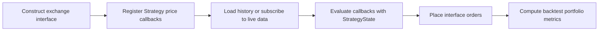
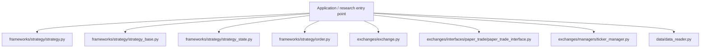
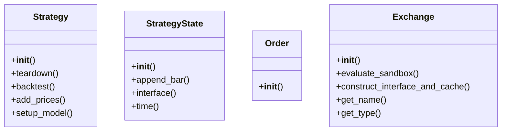
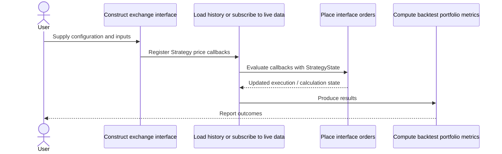
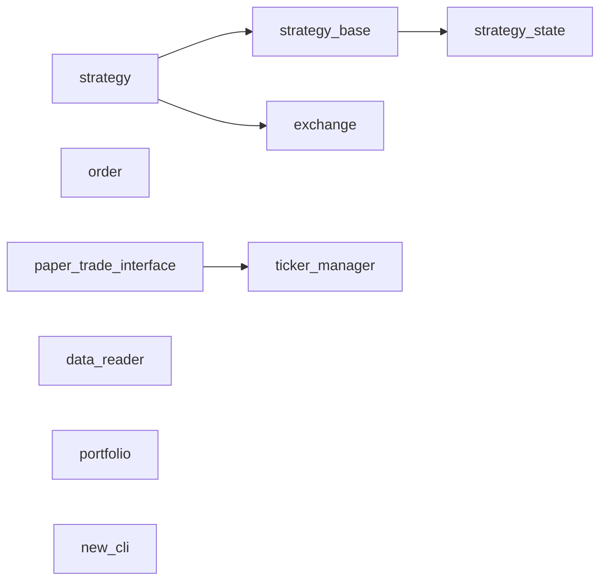
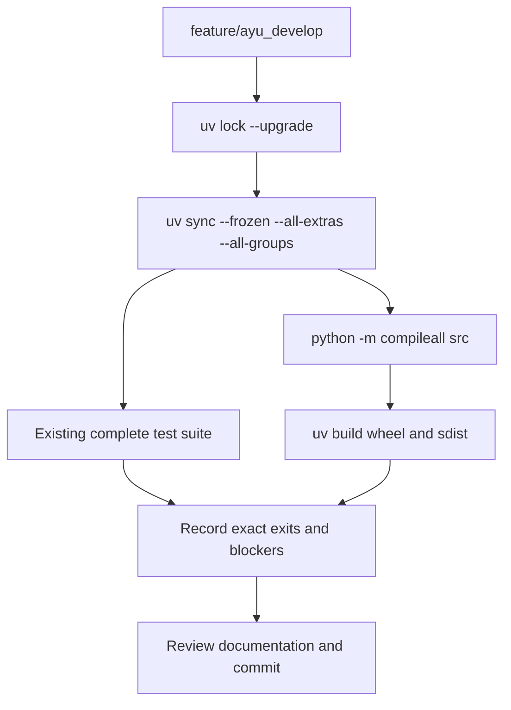

# blankly: development, architecture and operations

Updated 2026-10-12 on `feature/ayu_develop`; source snapshot `ebc9cb7ebbdd`. This guide follows the source in this checkout and separates available interfaces from verification evidence.

## Purpose and feature boundaries

Exchange-neutral strategy callbacks, market data and backtesting with reusable interface, order and strategy-state abstractions.

Exchange implementations adapt provider operations behind interfaces; Strategy schedules event callbacks and gives them a state object. Paper-trading/backtest interfaces simulate operations rather than requiring strategies to know the venue. Provider SDKs and indicator bindings remain optional extras, so deployment and live tests depend on the selected integration.

## Main workflow

The following is the repository-specific logical workflow. Runtime execution details remain in the linked source and the validation record.

1. Construct exchange interface.
2. Register Strategy price callbacks.
3. Load history or subscribe to live data.
4. Evaluate callbacks with StrategyState.
5. Place interface orders.
6. Compute backtest portfolio metrics.

## Components and ownership

The entry point composes the source modules below; arrows indicate review/navigation boundaries rather than a claim that every module is called in every run.

| Source | Declared classes / functions | Implementation role |
|---|---|---|
| [src/blankly/frameworks/strategy/strategy.py](../src/blankly/frameworks/strategy/strategy.py) | StrategyStructure, Strategy | Spot specific class for strategy |
| [src/blankly/frameworks/strategy/strategy_base.py](../src/blankly/frameworks/strategy/strategy_base.py) | EventType, StrategyBase | Abstraction for creating interval driven user strategies |
| [src/blankly/frameworks/strategy/strategy_state.py](../src/blankly/frameworks/strategy/strategy_state.py) | StrategyState | Class to pass in the current Strategy State |
| [src/blankly/frameworks/strategy/order.py](../src/blankly/frameworks/strategy/order.py) | Order | Class to carry out orders |
| [src/blankly/exchanges/exchange.py](../src/blankly/exchanges/exchange.py) | Exchange | Inherited exchange object. |
| [src/blankly/exchanges/interfaces/paper_trade/paper_trade_interface.py](../src/blankly/exchanges/interfaces/paper_trade/paper_trade_interface.py) | PaperTradeInterface | Paper trade exchange constructed from other interfaces |
| [src/blankly/exchanges/managers/ticker_manager.py](../src/blankly/exchanges/managers/ticker_manager.py) | TickerManager | Script for managing the variety of tickers on different exchanges. |
| [src/blankly/data/data_reader.py](../src/blankly/data/data_reader.py) | DataTypes, FileTypes, DataReader, __FormatReader, PriceReader, EventReader | A reader for handling a variety of data formats |
| [src/blankly/metrics/portfolio.py](../src/blankly/metrics/portfolio.py) | cagr, cum_returns, sortino, sharpe | General indicators & metrics for blankly |
| [src/blankly/deployment/new_cli.py](../src/blankly/deployment/new_cli.py) | validate_non_empty, create_model, add_key_interactive, init_starter_model | Updated CLI for interacting with and uploading blankly models. |
| [src/blankly/indicators/indicators.py](../src/blankly/indicators/indicators.py) | _check_tulipy, bbands, wad, wilders | Tulipy wrappers |
| [src/blankly/__init__.py](../src/blankly/__init__.py) | Package data / configuration | __init__ file to give the module access to the libraries. |
| [src/blankly/__main__.py](../src/blankly/__main__.py) | Package data / configuration | See the public declarations and implementation linked here. |
| [src/blankly/data/__init__.py](../src/blankly/data/__init__.py) | Package data / configuration | Datareader types & imports |

## Class design

Methods and inheritance edges are taken from the selected declarations in the actual source. A missing edge means composition or an external base is not asserted here.

## End-to-end interaction

This sequence presents the responsibilities of the main workflow, including the state/result boundary. The linked classes and functions provide the exact method-level contract.

## Source dependency direction

These edges are actual explicit imports between the selected source modules. Dynamic imports, re-exports and third-party internals are omitted.

## Design details and extension points

### `Strategy`

Source: [src/blankly/frameworks/strategy/strategy.py](../src/blankly/frameworks/strategy/strategy.py).

The class contract is defined by its linked implementation.

- `teardown`: See implementation for the complete contract.
- `backtest`: Turn this strategy into a backtest.
- `add_prices`: Directly add prices to the strategy
- `setup_model`: See implementation for the complete contract.
- `start`: Run your model live!

### `StrategyState`

Source: [src/blankly/frameworks/strategy/strategy_state.py](../src/blankly/frameworks/strategy/strategy_state.py).

The class contract is defined by its linked implementation.

- `append_bar`: See implementation for the complete contract.
- `interface`: Get the interface object that the strategy is running on. Use this to interact with your exchange.
- `time`: Get the time from the strategy. This will automatically switch to match the correct times during backtesting

### `Order`

Source: [src/blankly/frameworks/strategy/order.py](../src/blankly/frameworks/strategy/order.py).

Order Type

### `Exchange`

Source: [src/blankly/exchanges/exchange.py](../src/blankly/exchanges/exchange.py).

The class contract is defined by its linked implementation.

- `evaluate_sandbox`: This will try to maintain compatibility with older versions if they fail to pivot to the new version immediately
- `construct_interface_and_cache`: If you are a contributor, you need to modify this function to add exchanges The core functions that creates the interface based on the exchange type & automatically caches
- `get_name`: See implementation for the complete contract.
- `get_type`: See implementation for the complete contract.
- `get_preferences`: See implementation for the complete contract.

## Repository layout and resources

Installable packages live under `src/`. `pyproject.toml` defines package metadata, build requirements, optional integrations and development dependencies; `uv.lock` records resolved versions, and `.python-version` selects the local interpreter. This layout keeps an accidental checkout import from substituting for the installed wheel. Package resources remain beside their owning modules and are included by the build backend. Existing upstream examples, fixtures, scripts and documentation retain their separate roles.

## Maintenance compatibility and evidence

- The full pytest suite is attempted without changing discovery. Live exchange test collection reads missing Keys.json and cannot proceed without the original credential setup.
- The retained Alpaca SDK requires msgpack==1.0.3; that exact compatible pin is preserved instead of forcing a contradictory latest major.
- Python 3.15 actual installation succeeds including source builds.

## Development and verification workflow

See [development commands](development.md) and [validation evidence](validation.md) for interpreter selection, dependency exceptions, full-suite results and remaining blockers. No additional test cases were introduced by this maintenance.
